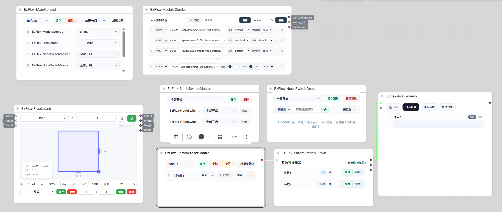

# Comfyui-EzFlex-Presets (V1.3.0)

**English** | [中文](README_ZH.md)

A preset, media and long-video toolkit for ComfyUI, built with AI assistance. **23 nodes**, all under the `EzFlex` category.



Demo video (Bilibili): [watch](https://www.bilibili.com/video/BV1T8hy6JEf4)

## Node list (23)

**Control / presets**
- Main Control (`EzFlex-MainControl`)
- Models Combo Loader (`EzFlex-ModelsCombo`)
- Resolution / Latent Selector (`EzFlex-FreeLatent`)
- Node Switch Master (`EzFlex-NodeSwitchMaster`)
- Node Switch Group (`EzFlex-NodeSwitchGroup`)
- Param Preset Control (`EzFlex-ParamPresetControl`)
- Param Preset Output (`EzFlex-ParamPresetOutput`)

**Preview / prompt**
- Preview Any (`EzFlex-PreviewAny`)
- Prompt Helper (`EzFlex-PromptHelper`)

**Media**
- Media Loader (`EzFlex-MediaLoader`)
- Media Out (`EzFlex-MediaOut`)
- Merge List (`EzFlex-MergeList`)
- Split List (`EzFlex-SplitList`)
- Reroute (`EzFlex-Reroute`)

**Long video / loops**
- Time Plan (`EzFlex-TimePlan`)
- Motion Context (`EzFlex-MotionContext`)
- Split Video (`EzFlex-SplitVideo`)
- Segment Panel (`EzFlex-SegmentPanel`)
- Time Line (`EzFlex-TimeLine`)
- Video Components (`EzFlex-VideoComponents`)
- Loop Start (`EzFlex-LoopStart`)
- Loop End (`EzFlex-LoopEnd`)

**Preprocessors**
- Controlnet Preprocessor (`EzFlex-ControlnetPreprocessor`)

## Version

Current version: **V1.3.0** (the version number stays fixed; later work is merged incrementally).

- **V1.3.0 stable**: two continuation modes — `keyframe` (pin the previous latent tail as guide rows; fast) and `masked` (freeze the AV prefix with `noise_mask`; exact continuity, roughly an order of magnitude slower per step). Both share `pin_next_head`, which on rerun pins the next segment's visible head at this segment's tail.
- Audio in `masked` mode always matches the video context window (same head trim); `keyframe` keeps the longer guide window (22↔24 = 40 ticks, 39↔39 = 65 ticks).
- Saved files follow ComfyUI formats: LATENT → `.latent`, single-entry CONDITIONING → `.safetensors`, MESH → `.glb`, AUDIO → `.wav`, VIDEO → `.mp4`, frames → PNG, other tensors → `.pt`.
- `TimePlan` links video context ↔ transition audio (`ceil(n/3)*3`; 39↔39 and 90↔90 are tick-exact).

- **V1.3.0**: the long-video suite — `TimePlan` (planning), `MotionContext` (pin the previous latent tail), `SegmentPanel` (per-segment save + assemble), `SplitVideo` (card-based slicing), `TimeLine` (timeline view / rerun), `VideoComponents` (split a VIDEO).
- `TimePlan`: three-column panel (preset / save / delete, align / custom / max, then the parameter rows); the custom-duration dialog supports add/remove segments, live totals, `×`/Cancel = discard, Save/click-outside = save.
- `SplitVideo`: up to 16 cards; `loop` / `one` / `frames`; outputs frames / video / GIF / audio; the video output is a lazy trim (no eager re-encode).
- `PreviewAny`: full container ↔ video-codec ↔ audio-codec constraints, real HDR ↔ SDR tone mapping, metadata on copy paths; up to 16 inputs.
- `SegmentPanel`: segments stay MP4; separate segment/final encoding settings in the order format / codec / FPS / CRF / bit depth / colour space.
- `TimeLine`: fixed context menu; "Set overall duration" opens TimePlan's custom dialog directly.

**Earlier versions**

- V1.3.0 Beta3: Prompt Helper find/replace display; PreviewAny save no-overwrite.
- V1.3.0 Beta2: Prompt Helper operation logic; right-click quick tools.
- V1.3.0 Beta: random tag / category / card-manager image generation; MediaLoader / MediaOut port rework; loop nodes; tag/card previews as standalone files; Ctrl+Z/Y canvas guard.
- V1.2.12: tag-system performance, card content fill, PreviewAny saving.
- V1.2.11: random/exclude tags, related tags, hide NSFW, finer categories, API error hints.
- V1.2.10: ModelsCombo first-port disconnect, preset loss.
- V1.2.9: PreviewAny generation info, NodeSwitchGroup copy matching.
- V1.2.8: PreviewAny batch image preview.
- V1.2.7: preview-image disappearance, black-label text, official node alignment.
- V1.2.6: theme system, FreeLatent canvas, data-storage cleanup.
- V1.2.5: random tags, bundled tag library, preview-image cleanup, LoRA trigger words, loaded-model browser, black-tag fixes, card collapse.
- V1.2.4: Prompt Helper big update: tag system / card manager, security.
- V1.2.3: bug fixes, security, node enhancements.
- V1.2.2: NodeSwitchGroup dropdown, ParamPreset validation, FreeLatent preset position, MediaLoader popup / 3D / preview speed, PromptHelper highlight.
- V1.2.1: Node 2.0 click fixes for PromptHelper / MediaLoader / MediaOut; collapsible rows; security hardening.
- V1.2.0: security hardening; MainControl EN / 中文.
- V1.11: Prompt Helper overhaul and fixes.
- V1.1: node polish, Prompt Helper improvements, compatibility fixes.
- V1.05: Prompt Helper "reference media" and stronger `@media`.
- V1.04: MediaLoader / MediaOut; Prompt Helper overhaul.
- V1.03: README cleanup; FreeLatent force override; align default 8; Prompt Helper node.
- V1.02: ModelsCombo gallery/search.
- V1.01: ParamPresetControl preset-switch wiring.
- V1.0: first stable release.

## Install

- Put this folder under `ComfyUI/custom_nodes/` and restart ComfyUI.
- The plugin **only needs `mutagen` as an extra** (audio/video tags); torch / numpy / Pillow / safetensors / av ship with ComfyUI. Or `pip install -r requirements.txt`.
- **`EzFlex-ControlnetPreprocessor` needs [comfyui_controlnet_aux](https://github.com/Fannovel16/comfyui_controlnet_aux)** — that pack ships the 47 preprocessors and their weights. Without it the node still loads but the list is empty.
- Optional (deliberately not in requirements): `llama-cpp-python` (in-process llama mode), `gguf` / `onnx` (metadata cards). Or `pip install -e .[llama,metadata]`.

## Usage

Search `EzFlex` in the node list. After front-end changes press `Ctrl+F5`; after Python/route changes restart ComfyUI.

### Minimal long-video wiring

```text
TimePlan.timeplan ──► MotionContext.timeplan
MotionContext.positive ──► sampler.conditioning
LoopStart.index ──► TimePlan.index (optional, plan per round)
LoopStart.valueK (previous latent) ──► MotionContext.context_latent
SegmentPanel.images / audio ◄── VAE decode
SegmentPanel.video / timeplan ──► TimeLine
```

- `MotionContext` pins the previous tail into this segment; it does not trim. `SegmentPanel` trims `overlap + tolerance` from the plan.
- `SplitVideo` slices source video; it is not the timeline view.
- Segment saving and final assembly live in `SegmentPanel`; TimeLine's rerun / trim / replace all go through the same path.

## Node features

### Main Control (`EzFlex-MainControl`)

- Drives overall behaviour; presets can be combined, saved and deleted.
- Card list: `ModelsCombo`, `FreeLatent`, `NodeSwitchMaster`, `ParamPresetControl` — each with its own preset dropdown, drag-reorderable.
- A master preset records the four nodes' current presets and cascades them down on switch.
- Quick load: add other EzFlex nodes in one click (`MediaOut` is created by `MediaLoader` itself).
- Language: 中文 / English.
- Themes: 16 palettes (Light / Lilac / Sage / Nord / Minimal Cool Grey / Warm Caramel / Cool Haze Blue / Deep Space / Morandi Purple-Grey / Mermaid Core / Chocolate / Klein Blue / Cloud White / Banana Yellow / Burgundy / Deep Teal) repainting all open panels instantly.

### Models Combo Loader (`EzFlex-ModelsCombo`)

- Freely combine UNet / CLIP / VAE / Checkpoint / LoRA.
- Presets: save / delete / switch combinations.
- Preview: model covers in the dropdown; gallery browsing (needs JSON from ComfyUI-Lora-Manager).
- Loaded-model browser: the picker / gallery marks currently loaded models and lets you remove or replace them.
- Outputs: `MODEL / CLIP / VAE 1..32` according to card count and type; LoRAs chain after their target model in card order; port names are `custom_name_model/clip/vae`.
- Fixed trailing `trigger_words` (STRING); empty without LoRA.
- Reorder cards freely; ports are not reshuffled before loaders are ready, so links and presets survive reloads.

### Resolution / Latent Selector (`EzFlex-FreeLatent`)

- Canvas: drag to create the matching empty latent; hold Ctrl to disable snapping.
- Width/height input; optional external `width/height/batch_size`.
- Align: `Opt / Std` algorithm with a resolution step; affects manual input, size presets, ratio and MP calculations.
- MP (megapixels); ratio presets (built-in + custom); size presets (built-in + save/delete from current actual size).
- Info panel: live actual size, ratio, MP.
- Outputs: empty latent, Width, Height, Batch.
- Force override: green = ignore external width/height/batch and use panel values; controls unlock only when at least one input is connected.

### Node Switch Master (`EzFlex-NodeSwitchMaster`)

- Drives Node Switch Group behaviour; combine / save / delete presets.
- Each row maps to one `NodeSwitchGroup` instance on the canvas.

### Node Switch Group (`EzFlex-NodeSwitchGroup`)

- Switches grouped nodes between `on / off / bypass (ignore)`.
- Presets: save / delete; per-instance — deleting the node removes its presets.
- Group matching: by name / by colour, including subgraphs; auto-sort cards by position / name.
- Works with Node Switch Master for multi-group control.

### Param Preset Control (`EzFlex-ParamPresetControl`)

- Green/red parameter buttons: whether a parameter appears in the output list and group dropdown.
- Parameter group dropdown: choose all or a specific parameter.
- Presets: save / delete parameter groups.
- Types: int, float, bool, string, complex, tuple, list, set, dictionary.
- Drag-reorder group cards and parameter cards.
- Outputs: one port per group card; multi-parameter ports red, single-parameter grey.

### Param Preset Output (`EzFlex-ParamPresetOutput`)

- Enable/disable parameter output; disabled outputs neutral values: int→0, bool→false, float→0.0, string etc.→empty.
- Type hint: shows the actual type; on mismatch with ParamPresetControl it outputs string and marks red.
- Value preview popup.
- Ports follow parameter count 1:1; disabled parameters keep their port, so no rewiring is needed.

### Preview Any (`EzFlex-PreviewAny`)

- Up to **16** any-type inputs; auto-detects the type and builds a preview card; cards follow connections and can be reordered.
- Preview-only by default; click "auto save" to write files, with optional location and save options.
- Save options follow the format: lossless formats have no bitrate, lossless images no quality; IMAGE / AUDIO / VIDEO offer "keep source" (file-backed values are copied, not re-encoded).
- LATENT, CONDITIONING and MESH save with ComfyUI formats too: `.latent`, `.safetensors` (single entry) and `.glb`; JPEG/WebP carry the workflow metadata as EXIF/XMP.
- File names support `%year% %month% %day% %hour% %minute% %second%`; empty uses the card name with auto numbering.
- Batch images: **64** frames per card by default (configurable on the panel; 0 = unlimited); multi-image save type (auto / batch images / video / animation) is per card.
- Supported types:

| Type | Accepts | Preview | Formats |
|---|---|---|---|
| IMAGE | `[B,H,W,C]` tensor | thumbnail + full view; batches page / save as sequence / video / animation | PNG / JPEG / WebP / BMP / TIFF / animation (WebP / PNG / GIF) |
| MASK | 2D / 3D tensor | grayscale PNG | PNG |
| AUDIO | `{waveform,sample_rate}` / `(waveform,sr)` / file object | player | WAV / MP3 / FLAC / OGG / M4A / AAC |
| VIDEO | `VideoFromFile` / `VideoFromComponents` | first-frame cover + player | MP4 / WebM / MOV / GIF / AVI / MKV |
| CONDITIONING | dict with `conditioning/context` | text summary | — |
| LIST / TUPLE / SET | list / tuple / set | indexed value tree | JSON |
| DICT | dict | key/value tree | JSON |
| STRING / INT / FLOAT / BOOLEAN | Python values | text (truncated + popup) | TXT / MD / JSON / CSV / LOG / HTML |
| LATENT | `{samples}` | shape / dtype summary | — |
| FILE_3D / MODEL_3D | `File3D` | offline three.js viewer | glb / gltf / obj / fbx / splat |
| MESH | `Types.MESH` | temp OBJ → three.js | vertices ≤500k, faces ≤1M |
| SPLAT / VOXEL | `Types.SPLAT` / `Types.VOXEL` | text summary | — |
| MODEL / CLIP / VAE | ComfyUI objects | metadata card | safetensors / gguf / onnx / ckpt / pt |
| CONTROL_NET / CLIP_VISION / STYLE_MODEL / UPSCALE_MODEL / LORA_MODEL / GLIGEN / SAMPLER / SIGMAS / GUIDER / NOISE / SEGS | matching objects | text summary | — |
| EMPTY | not connected | "(not connected)" | — |

- Video constraints: container ↔ video codec ↔ audio codec are fully validated (front-end convergence + back-end check); e.g. WebM only accepts VP9/AV1 + Opus.
- Real HDR ↔ SDR tone mapping: HDR→SDR uses Hable; SDR→HDR re-encodes in BT.2020 / PQ·HLG; mislabeled output is refused on failure.
- Copy saves also carry prompt / workflow metadata (PNG iTXt, container metadata for video).
- Model types save info text only, never the model file; absolute save paths are limited to `output/` and locally registered folders.

### Prompt Helper (`EzFlex-PromptHelper`)

- Cards: up to **32**; add/remove, drag-reorder, double-click rename; each card has Default / Optimized pages and a merge toggle (green = merged).
- Editor: bold/italic/underline/strike, alignment, font size/colour, highlight, first-line indent, find & replace, colour picker, full/half-width conversion; a skill button inserts a `*.md` line by line at the caret.
- Media references: reads generator media ports live and numbers `@image N / @video N / @audio N`; the reference window lists media per generator node with + insert / − remove / right-click global library.
- Prompt rules: 15 built-in rules under Settings · Rules (including "no compile" and "use API") plus custom rules (editable, bilingual, 中|EN) that compile reference marks into vendor syntax (`<Picture 1>`, `@image1`, …).
- Optimize: tool menu offers API / TextGenerate / llama; use once or enable runtime auto-optimize. The three auto toggles are mutually exclusive and failures stop with an error.
- Quick weight: with the caret on a tag, `Ctrl+↑ / Ctrl+↓` adjusts by the weight step (default 0.05); brackets are removed when the weight returns to 1.
- Collapse: toolbar and tab-row collapse bars in the card popup / overall editor; state is stored in config; both collapsed merge into "expand all".
- Card manager: save cards as presets (`user/EzFlex/prompts/<name>.json`), save only selected cards, load, delete.
- Ports: dynamic `media_in_1..16` (ANY) + `card_in_i` (STRING) per card; outputs "merged prompt" + one STRING per card. A wired `card_in_i` overrides that card (dimmed on the panel) and still takes part in merge/optimization.
- Loop mode: adds an `index` (INT) input at the end and renames the first output to "loop output", emitting only card `index`; other card outputs stay 1:1.
- Settings: General / Rules / API / TextGenerate / llama / Paths; the header toggles tile / popup mode.
- Tag entry: **editor right-click menu → Tag** (the footer button was removed on 2026-10-05); tag-hint candidates can also be picked directly.

#### Tag system

- Data: `user_data/PromptHelperLib/*.csv` — 12 files: 8 tag libraries + `_tag_kind` (fine categories) / `_zh_CN` (Chinese) / `_e621_species` / `_furry_extra`; ~26 MB and **must ship with the repo**, otherwise the tag panel has neither libraries nor Chinese.
- Two spaces: **library side** (built-in categories / favourites / placement) + **My tags** (copies of library tags that you can freely edit). The fixed "Uncategorised" node; "My tags" expands by default.
- Category tree: both sides support create / rename / delete / drag-reorder / drag to become a child; right-click blank creates at the end of the current level; duplicate names at the same level are rejected.
- Tag manager: multi-select, drag to recategorise, library tag → My tags (copy; the library copy stays), rename, delete, move to; batch bar.
- Tag cards: preview image, favourite star, dashed border for My copies, batch drag; card count / height / display mode (cover thumb / contain full) are global in `localStorage['ezflex.tagCardSize']` / `ezflex.tagPreviewFit`; pager like the card manager.
- Previews: standalone image files (`tag_preview`), cleanable separately, never embedded in tag records.
- Search / filter: search box + filter dropdown — favourites only, exclude e621, exclude keywords (multi-line, each line removable), exclude categories (real category tree multi-select), exclude tags with popularity below N, hide NSFW, exclude furry; the three "…" items open a side panel and clicking the same item again closes it.
- Related tags: `_related.csv`; shown line by line in the insert panel and can be inserted.
- Insert panel: movable floating window (like find/replace), with an "inserted" box on top, groups on the left and cards on the right; clicking a card inserts at the caret; the inserted box can be edited as plain text; inserted tags are chips that can be deleted or quick-weighted.
- Tag hint: typing in the body pops candidates (case-insensitive, Chinese / alias mapping); Enter / Tab / click confirms; after confirming, an automatic symbol can be appended (default `,`, configurable in Settings · Other).
- Quick weight: caret on a tag, `Ctrl+↑ / Ctrl+↓` changes the weight by the step; the insert panel's "inserted" box shows `(tag:1.05)`; brackets are removed when the weight returns to 1; range 0.05–10.
- Random tags: the card toolbar's "random tag" clears the card and regenerates immediately; "auto random tag" regenerates at every queue (mutually exclusive). The random-group dialog has category + count + toggle + minus per row; groups live in `localStorage['ezflex.randGroups']`.
- The tag panel opens from the editor right-click menu (card popup and overall editor both work; collapsing the toolbar does not affect it).
- Library selection is stored in `localStorage['ezflex.tagLib']`; tag data in `user_data/ezflex_prompt_tags.json`.

#### Sliders and optimization logic

- **Two independent layers**: the Default / Optimized slider in a **card** popup only affects **that card's output port**; the slider in **overall edit** only affects the **merged prompt** port. Their optimized slots never overwrite each other.
- **Tool optimization** (manual, one call):
  - Card popup "Tool → optimize prompt": source is fixed to that card's **Default** page; the result fills that card's Optimized slot and the slider switches to Optimized; the Default body is untouched.
  - Overall edit "Tool → optimize prompt": source is each card's **Default** body joined in order with the card merge separator (merged = green cards; empty cards take no slot), **one single call**; the result goes to the "overall optimization result" and the overall slider switches to Optimized; the original cards are unchanged.

| Slider | Default | Optimized | Behavior |
|---|---|---|---|
| Default / Optimized | has | none | optimize using the default prompt → fills the optimized slot, slider switches to Optimized |
| Default / Optimized | has | has | optimize using the default prompt → **overwrites** the optimized slot (does not reuse hand-edited optimized text) |
| any | empty | has / none | pops "this card has no prompt content to optimize." |

- **Runtime optimization (overall edit → merged prompt)**: active when any of the three auto-optimize toggles is on. The optimized slot is a "memo": if it has content it is not re-called, only when empty. Failures (API / TextGenerate / llama) **stop with red**.

| Overall slider | Default | Optimized | Behavior |
|---|---|---|---|
| any | has | none | optimize once overall → write to "overall optimization result" → slider switches to Optimized → output it |
| Optimized | has / empty | has | output the "overall optimization result" directly (**no re-optimize**), slider unchanged |
| Default | has | has | output the **default merged** (the optimized version is kept unused, and no optimization), slider unchanged |
| Default | empty | has | output the "overall optimization result", slider switches to Optimized |
| any | empty | empty | output empty (the user wrote nothing), slider unchanged |

- **Each card → "card i" port**: when **merge is green** (joins the merge) it is **not optimized separately** at runtime, strictly output by that card's slider — Default outputs Default, Optimized outputs Optimized; **pointing at an empty slot outputs empty** (no fallback). When **merge is gray** (does not join the merge) it is **optimized separately on demand** (the result only reaches its own port):

| Slider | Default | Optimized | Card port |
|---|---|---|---|
| any | has | none | optimize the default separately once → fills that card's optimized slot → port = result, slider switches to Optimized |
| Default | has | has | port = Default (the optimized version is kept unused, and no optimization), slider unchanged |
| Optimized | has | has | port = optimized version (no re-optimize), slider unchanged |
| any | empty | has | port = optimized version (no re-optimize); if the slider was on Default it switches to Optimized |
| any | empty | empty | port = empty, slider unchanged |

- **All three toggles off**: no optimization call, with the same "strictly by slider, empty stays empty" rule. Overall: Default → default merge (each card's Default body, filtered by merge, gray cards excluded); Optimized → overall optimization result; empty stays empty, no fallback, no filling in. Each card (green and gray the same): Default → that card's Default body; Optimized → that card's optimized content; empty stays empty. A card slider **does not affect** the merged prompt.
- **Rule compilation (referencing media), and at which step**: the body sent to the API / TextGenerate / llama is the **uncompiled original text** (`@image1` / `@video1` / `@audio1`); the system prompt explicitly asks the model to **keep those marks as-is** (no translating, rewriting or renumbering). Both optimized slots also store the **model's original text** (uncompiled) — you can still recompile with a different rule set and never lose the mapping. **Only the output ports go through rule compilation**: the "card i" port, and the default merge / overall-optimized content used by the "merged prompt"; compilation is idempotent. If the model **keeps** `@image1` → the output automatically becomes that rule's syntax (e.g. `<Picture 1>`); if the model **translates/rewrites** it into natural language ("the first picture"), the mark is gone and no compilation can recover it (only the system prompt can lower the odds, or use a more obedient model).

### Media Loader (`EzFlex-MediaLoader`)

- Presets: save/delete groups, card groups and names.
- Parameters: cards per row, card height multiplier.
- Groups / card groups / media cards: drag-reorder, double-click rename, context menu, long-press merge, hover info, click preview, delete.
- Browser: explorer-style (directory tree, back/forward/up/refresh, manual path, search, multi-select).
- Outputs: one `EZFLEX_MEDIA_CARD` port per card (only for `MediaOut`); output modes split / card / card group / group, with optional merging.
- Loads images / video / audio / 3D / text / other with the same values as built-in loaders.
- Extensions: images `.png .jpg .jpeg .webp .gif .bmp .tif .tiff`; video `.mp4 .webm .mov .mkv .avi .m4v`; audio `.mp3 .wav .flac .ogg .aac .m4a .opus .wma`; 3D `.obj .glb .gltf .fbx .stl .ply .spz .splat .ksplat .3ds .dae .blend`; text/other → STRING.
- "Load output" creates and wires an `EzFlex-MediaOut`.
- Fixed / loop mode: a top "loop" toggle; settings contain splice and loop tabs. The loop tab starts with slot presets (`default`, `minimaxH3`, non-deletable), then counts for image / video / audio / text / model / other. At runtime `index` selects the matching card group; out of range yields None; MediaOut follows the slot ports automatically.
- In fixed mode, card groups only draw preset slots (empty slots show a type icon); drag-upload / single add / batch add all enforce type limits. A card group can be marked as a "loop card group": it participates in every index but takes no number and no order slot; with one group every segment reuses it.
- Root security: only ComfyUI `input` / `output` by default; other folders must be registered manually and only from localhost. Never register drives, home directories or project roots; with `--listen 0.0.0.0`, a tunnel or a reverse proxy, registered folders may be reachable by others.

### Media Out (`EzFlex-MediaOut`)

- Input: one `EZFLEX_MEDIA_CARD`, wired to a MediaLoader card port.
- Outputs: neutral ports typed/coloured by the real value — IMAGE / VIDEO / AUDIO / FILE_3D / STRING.
- Modes: split / card / card group / group. Split = one port per file; other modes merge per structure.
- Merge: images → batch `[B,H,W,C]`; audio → concatenated (sample rates must match, mono is upmixed); text → newline-joined; mixed types / rates raise an error suggesting split.
- Batch settings (card / card group / group): target size "first / specified", fit crop / pad / stretch, max items (0=all), start index.
- Switches: split mode keeps disabled ports and outputs `None` (re-enable without rewiring); other modes drop disabled items. At queue time, disabled-but-connected inputs are removed from the submitted prompt; canvas links and the saved workflow are untouched.

### Merge List (`EzFlex-MergeList`)

- Joins multiple inputs, in order, into one list; inputs are added/removed as needed (up to 16).
- A list input is flattened in; anything else is appended as one item.
- One `*` list output for `SplitList` or other list nodes.
- Order follows the top-to-bottom port order on the canvas, not `input_N` numbers.

### Split List (`EzFlex-SplitList`)

- Splits one list into multiple outputs (inverse of MergeList).
- Outputs are added/removed as needed (up to 16), always keeping at least one; unconnected ports get no label.
- Commonly used to take accumulated loop segments out one by one.

### Reroute (`EzFlex-Reroute`)

- Per-port 1:1 passthrough: input i → output i; no merge or split.
- Adds ports as you connect (up to 32); each port can be named.
- Port/link colours follow the upstream output (VAE red / CLIP yellow / MODEL purple …).

### Time Plan (`EzFlex-TimePlan`)

- Three-column panel. Row 1: preset dropdown / save / delete; row 2: align dropdown / custom / max; rows 3–5: total·segment·FPS, overlap·tolerance·trim tail, transition audio·B·S.
- Preset and align cells have no labels; other rows use a fixed label + input; input text is centred.
- Minimum width 660, enough for three columns.
- Model presets: `minimax_h3` / `wan` / `ltx`; `B` / `S` are the frame grid (H3 = 5 / 17).
- `Max` fills `max_frames` with the current model's maximum frame count in one click.
- Align: `align` snaps to the grid; `strict` raises on overflow.
- Three built-in presets are read-only; custom plans can be saved/deleted.
- "Custom" opens the duration dialog: add/remove segments, live totals and per-segment frames; `×`/Cancel discards; Save/click-outside saves. Edits persist with a debounce, and TimeLine follows live.
- Outputs: `timeplan` (`EZFLEX_TIMEPLAN`) + `frames` (frames to generate for this segment).
- Two-way sync with TimeLine: dragging a segment / changing duration writes `segOverride`.

### Motion Context (`EzFlex-MotionContext`)

- Pins the previous AV latent's tail (`context_length` frames) into this segment's conditioning (`minimax_keyframes`, `img_update=False`, hard-locked).
- Zero VAE round trip: slices the previous sampled latent directly (no decode + encode), saving one lossy pass and memory versus AddGuide.
- Inputs: `positive`, `latent` (this segment's AV latent, used for frame count / shape check), `context_length` (default 22), `context_audio_length` (default 24), `follow_plan`.
- Optional: `context_latent` (previous AV latent, usually `LoopStart.valueK`), `context_video_latent` / `context_audio_latent` (override either half), `timeplan`.
- With `follow_plan` on and `timeplan` wired, `context_length` = `overlapFrames` (**only overlap is pinned**; `tolerance` is extra head burn-in that is trimmed, not pinned) and the audio length comes from TimePlan; overlap=0 pins nothing.
- Two modes (`mode`): `keyframe` (default) pins the previous tail as `minimax_keyframes` rows (more tokens); `masked` writes the same tail into this latent's prefix with `noise_mask` (0 = frozen, 1 = generate) and leaves conditioning untouched.
- `masked` also outputs `latent` (third port) — wire it to the sampler's `latent_image`; conditioning passes straight through. Nodes that rebuild the latent drop the mask, so keep the latent direct.
- `masked` forces the audio prefix to the video window (same head trim); `keyframe` uses `context_audio_length` as a guide.
- `pin_next_head` works in both modes: `keyframe` appends a tail keyframe, `masked` writes tail rows with mask 0. It only fires on rerun, when `timeplan.nextRef` exists.
- Outputs: `timeplan` + `positive` + `latent`.
- `pin_next_head` (default off, experimental): when TimeLine re-runs this segment, pin the next segment's saved latent **visible head** (skipping its own overlap/tolerance) at this segment's tail; TimeLine detects the port from `valueN → MotionContext.context_latent` instead of hardcoding v2.
- Does not trim; `SegmentPanel` trims `overlap + tolerance`.
- Rerun: LoopEnd records media types; LoopStart restores the previous segment's VIDEO from `seg_XXXX.mp4`; `nextRef` pins the **next segment's head latent** at this segment's tail for the last segment of a rerun range (TimeLine sets it automatically).
- Changing value ports: TimeLine inspects the actual `LoopStart.valueN → context_latent / SplitVideo.video_* / AUDIO / IMAGE` wiring and writes `resumeMedia` + `nextRef.latentPort`; as long as the semantic wiring is unchanged, moved ports still resolve to the same files.

### Split Video (`EzFlex-SplitVideo`)

- Up to **16 cards**; one card = one `video_N` input + one `Segment N` output; optional `timeplan` passthrough (only `loop` mode needs it).
- Modes:
  - `loop`: the current TimePlan segment (`netStart / netDuration`);
  - `one`: a time window `[one_start, one_end)`;
  - `frames`: a frame range; negative indices count from the end; `end_frame=0` = end of video; e.g. `-22, 0` = last 22 frames.
- Each card can override mode / values / output type (turn off its "master" toggle); the master row applies to the others.
- Four outputs:
  - `frames`: IMAGE batch;
  - `video`: lazy-trimmed `VIDEO` (`as_trimmed`, no encode, no temp file; `SaveVideo` / `GetVideoComponents` honour the window, only preview transcodes once);
  - `gif`: frames saved as an animated GIF under `output/`;
  - `audio`: source audio for the same window (sample-accurate, no resample; `None` without an audio track).
- The first-row "Settings" button opens max-frames / stride:
  - `Max frames`: frames / GIF only, 0 = unlimited;
  - `Every N`: 0 = no thinning, N = keep every Nth frame; frames / GIF only; video / audio keep the full timeline.
- Decoding uses `container.decode()` so the H.264 tail B-frames are flushed (no lost last frames).
- If the input is already trimmed, windows / frame numbers are relative to that input (same nesting as built-in `Video Slice`).
- Same source + window reuses frame / audio / lazy-trim caches; `max_frames` truncates when hit.

### Segment Panel (`EzFlex-SegmentPanel`)

- Inputs: `images`, optional `timeplan`, optional `audio`.
- Fields: save folder, FPS, clean VRAM, assemble final, trim tail, internal rerun stop, plus two encoding groups.
- Clean VRAM = `gc.collect()` + `soft_empty_cache()`: releases Python garbage and free CUDA cache blocks only. It does **not** unload loaded models, so the next segment does not reload model weights.
- Two collapsible sections share the same order (two per row): **format / codec / FPS / CRF / bit depth / colour space**.
- Segments: format fixed MP4 (disabled placeholder); codec auto / h264 / av1.
- Final: format mp4 / mkv / webm; codec auto / h264 / h265 / av1; may follow the segment encoding except the container.
- Each segment is written immediately with a manifest; the last segment (or rerun stop) concatenates with ffmpeg into `final`.
- Seam handling (the row under Clean VRAM):
  - `Blend frames`: visible crossfade frames at each seam (xfade), 0 = off; the final gets shorter by that many frames per seam.
  - `Audio xfade (ms)`: audio crossfade per seam; 0 = follow the video blend duration; best used together with the video blend.
  - Both values are stored in the manifest; TimeLine's rerun / trim / replace go through the same `_ezsp_concat` and reuse them.
- Trim / replace segment / replace final / range rerun all re-run through the manifest; TimeLine's rerun / trim / replace reuse the same path.
- Segments stay MP4 for stable looping, preview and concatenation; only the final picks a container.
- HDR is tag-only for now (no tone mapping here; PreviewAny does tone mapping in its encode path).
- Outputs: `timeplan`, `images`, `audio`, `video`.

### Time Line (`EzFlex-TimeLine`)

- Inputs: optional `timeplan`, `video` (segment list, item i = segment i).
- View: large preview + bottom splice track; play / stop / mute / fullscreen / volume; exiting fullscreen syncs play, mute and volume back to the custom controls.
- Clicking a segment selects it and seeks to its net start; returning to segment 1 / the start needs only one click.
- Context menu (fixed):
  1. Set segment duration (#n)
  2. Set overall duration
  3. Regenerate this segment
  4. Regenerate to the end
  5. Regenerate selected segments
  6. Trim segment head/tail
  7. Restore segment trim
  8. Replace this segment video
  9. Replace final video
  10. Clear this segment cache
- "Set overall duration" opens the upstream TimePlan's custom dialog (same implementation / style) — not a separate total field.
- Regenerate / trim / replace write the manifest and reassemble the final.

### Video Components (`EzFlex-VideoComponents`)

- Input: `VIDEO` (SplitVideo / MediaLoader / built-in Load Video …).
- Nine outputs: `images`, `audio`, `fps`, `bit_depth`, `color_space`, `frame_count`, `duration`, `width`, `height`.
- Decoding matches the built-in `Get Video Components` (`video.get_components()`); metadata prefers the VIDEO object's own `get_bit_depth()` / `get_color_space()` so it matches the built-in outputs.
- `frame_count` is the actual decoded count; `duration` prefers container duration, else `frames / fps`.

### Loop Start (`EzFlex-LoopStart`)

- Loop entry; the panel has one `index` field (start round, default 0), read-only at runtime and incremented each round.
- Outputs: `index` (INT, always first) + `value1..20` (dynamic, one per connection).
- Inputs: `index` (optional, drive the start round from the graph) + `initial value1..20` (one per value port).
- Initial values: before feedback arrives, `valueN` outputs `initial valueN`; downstream nodes that cannot accept empty values (torch.cat / VAE …) need them, otherwise round 1 fails.
- The round count lives on Loop End.
- Ref cards (only used when reading files: `refPaths` or resume): role (`prev` / `cur` / `next`) + type (Frames / Video / Audio / Latent) + range. Normal rounds ignore the cards and pass the feedback value through; a Frames card slices the fed batch to the last N frames, video/audio pass unchanged.

### Loop End (`EzFlex-LoopEnd`)

- Loop trigger and exit; "rounds" = **total** rounds including the first: 0/1 = one pass, N = N passes.
- Inputs `value1..20` (dynamic, one-to-one with Start): whatever a port receives becomes the next round's Start value N.
- Outputs `timeplan` (passthrough) + `out1..20` (last round's values); wire a `MergeList` output into `valueN` to accumulate per-round lists.
- Do not wire End back into Start (cycle error); `outN` may only feed nodes outside the loop body.
- Two continuation modes: expand (default) / queue. Queue is stored on the paired `LoopStart` config (`queue: true`), enqueues one prompt per round, keeps the graph flat and can pause between rounds; each round is a separate prompt, so cross-round preview accumulation is lost and outputs must be released manually.
- Save cards: type is **Frames** or **Other**; each row shows its port number and the edge label shows `#K`. Frames writes the last N frames as PNG (non-frame values fall back to Other). Other follows ComfyUI formats: LATENT `.latent`, single-entry CONDITIONING `.safetensors` (multi-entry `.pt`), MESH `.glb`, AUDIO `.wav`, VIDEO `.mp4`, text `.txt`, other tensors `.pt`.

### Controlnet Preprocessor (`EzFlex-ControlnetPreprocessor`)

- Turns `comfyui_controlnet_aux` preprocessors into a card list; one card per preprocessor, ports follow the upstream node's real inputs/outputs (up to 64 input slots).
- Each card keeps its own parameters (model / weight, thresholds, resolution …), unlike the AIO node.
- Cards: drag-reorder, expand/collapse parameters, index, picker (category then node, submenu to the right, hover help), custom name (becomes the output port name), delete.
- Toolbar: preset dropdown + save/delete + add preprocessor + expand/collapse all.
- Ports are `*` (ANY) with no native strong typing; only preprocessors with IMAGE input and IMAGE first output are listed (47).
- Requires `comfyui_controlnet_aux`; without it the node loads but the list is empty.

## Directory structure

```text
Comfyui-EzFlex-Presets/
├── __init__.py          # 23 node classes + preset / output-type / media routes
├── pyproject.toml
├── README.md            # English
├── README_ZH.md         # Chinese
├── PROJECT_STATE.md     # project state / handover
├── docs/                # detailed references and research notes
├── locales/zh/nodeDefs.json  # official i18n: node names / descriptions / tooltips
├── user_data/           # preset store (runtime; PromptHelperLib tag library ships with the repo)
├── images/              # README images
└── web/                 # frontend panels (one per node; shared service/i18n/theme/media index/list view)
    ├── ezflex_service.js
    ├── ezflex_i18n.js
    ├── ezflex_theme.js
    ├── ezflex_media_index.js
    ├── ezflex_listview.js
    └── libs/ utils/ curves/   # local offline three.js and resources
```

## Notes

- A personal project, built with AI assistance, still being improved.
- Presets and caches live in `user_data/` and ComfyUI's `user/EzFlex/`; workflows store only each node's own configuration.
- Check local absolute paths (MediaLoader roots, SegmentPanel save folder) before sharing a workflow.
