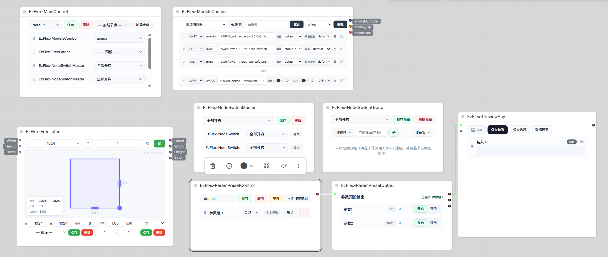

# Comfyui-EzFlex-Presets（V1.3.0 正式版）

[English](README.md) | **中文**

用于 ComfyUI 的预设 / 素材 / 长视频工具箱，使用 AI 辅助构建。共 **23 个节点**，全部在 `EzFlex` 分类下。



B 站演示视频：[点击观看](https://www.bilibili.com/video/BV1T8hy6JEf4)

## 节点列表（23）

**总控 / 预设**
- 总控制节点（`EzFlex-MainControl`）
- 模型组合加载器（`EzFlex-ModelsCombo`）
- 分辨率 / Latent 选择器（`EzFlex-FreeLatent`）
- 节点总控制（`EzFlex-NodeSwitchMaster`）
- 节点开关组（`EzFlex-NodeSwitchGroup`）
- 参数预设控制（`EzFlex-ParamPresetControl`）
- 参数输出控制（`EzFlex-ParamPresetOutput`）

**预览 / 提示词**
- 任意预览（`EzFlex-PreviewAny`）
- 提示词助手（`EzFlex-PromptHelper`）

**素材**
- 素材加载器（`EzFlex-MediaLoader`）
- 素材输出（`EzFlex-MediaOut`）
- 合并列表（`EzFlex-MergeList`）
- 拆分列表（`EzFlex-SplitList`）
- 转接节点（`EzFlex-Reroute`）

**长视频 / 循环**
- 时间规划（`EzFlex-TimePlan`）
- 运动上下文（`EzFlex-MotionContext`）
- 切分视频（`EzFlex-SplitVideo`）
- 分段面板（`EzFlex-SegmentPanel`）
- 时间轴（`EzFlex-TimeLine`）
- 视频组件（`EzFlex-VideoComponents`）
- 开启循环（`EzFlex-LoopStart`）
- 结束循环（`EzFlex-LoopEnd`）

**预处理器**
- 预处理器（`EzFlex-ControlnetPreprocessor`）

## 版本说明

当前版本 **V1.3.0 正式版**（版本号保持不变，后续功能以增量方式合入）。

- **V1.3.0 正式版**：长视频两种接续 —— `keyframe`（把上一段 latent 尾部钉成条件行，快）与 `masked`（用 `noise_mask` 冻结 AV 前缀，接缝最准，但每步慢一个数量级）；两者共用 `pin_next_head`，重跑时把下一段的可见头钉到本段尾部。
- `masked` 的音频窗口强制等于视频窗口（同一份裁头）；`keyframe` 仍用更长的参考窗口（22↔24 = 40 tick，39↔39 = 65 tick）。
- 落盘格式对齐 ComfyUI：LATENT → `.latent`，单条目 CONDITIONING → `.safetensors`，MESH → `.glb`，AUDIO → `.wav`，VIDEO → `.mp4`，帧序列 → PNG，其它张量 → `.pt`。
- `TimePlan` 视频上下文 ↔ 过渡音频联动（`ceil(n/3)*3`；39↔39、90↔90 为整 tick）。

- **V1.3.0**：长视频套件成型 —— `TimePlan`（时间规划）、`MotionContext`（上一段 latent 尾部钉入）、`SegmentPanel`（分段落盘 + 拼接）、`SplitVideo`（卡片式切分）、`TimeLine`（时间轴展示与重跑）、`VideoComponents`（VIDEO 拆组件）。
- `TimePlan` 三列面板：预设 / 保存 / 删除，对齐 / 自定义 / Max，参数三行；自定义时长弹窗支持加段、实时合计、`×`/取消丢弃、保存/点弹窗外保存。
- `SplitVideo` 最多 16 卡；`loop` / `one` / `frames` 三种切法；输出帧序列 / 视频 / GIF / 音轨；视频输出为懒裁剪（不提前重编码）。
- `PreviewAny` 增加容器 ↔ 视频编码 ↔ 音频编码完整约束、HDR ↔ SDR 真实色调映射、copy 路径元数据；输入上限 16 路。
- `SegmentPanel` 分段固定 MP4；分段与成片两套编码设置，字段顺序统一为格式 / 编码器 / FPS / CRF / 位深 / 色彩空间。
- `TimeLine` 右键菜单定稿；「设定整体时长」直接复用 TimePlan 的「自定义」弹窗。

**历史版本**

- V1.3.0 Beta3：优化提示词助手查找 / 替换显示；优化 PreviewAny 保存逻辑（避免覆盖）。
- V1.3.0 Beta2：优化提示词助手操作逻辑；新增右键快捷工具。
- V1.3.0 Beta：优化随机 tag；修复分类选择与库内分类不一致；新增重复分类提示；卡片管理新增生图；优化 MediaLoader / MediaOut 端口类型与操作；优化 PreviewAny 预览与保存；新增循环节点（MergeList / SplitList / LoopStart / LoopEnd / TimeLine / Reroute）；MediaLoader、PromptHelper 新增循环系统；标签 / 卡片预览改独立图片文件（`tag_preview` / `card_preview`）；提示词助手新增快捷权重 / 预览图显示模式 / 卸载显存；整体性能优化。
- V1.2.12：标签系统性能优化；修复卡片内容无法填充；优化标签提示与引用媒体冲突；修复 PreviewAny 无法保存某些类型媒体；优化保存逻辑。
- V1.2.11：修复 PromptHelper 若干前端 bug 与 API 调用 bug；新增 API 调用错误提示；标签系统新增随机匹配 / 排除字段、相关标签、隐藏 NSFW、细化分类；新增 anima2.9B 标签库。
- V1.2.10：修复 ModelsCombo 第一个端口切换窗口 / 刷新 / 重启断连；修复预设切换窗口 / 刷新丢失。
- V1.2.9：修复 PreviewAny 读取图片生成信息不对（提示词支持穿透连线读取）；修复 NodeSwitchGroup 复制后匹配不到节点；ModelsCombo 有配置时触发词端口常驻（无 LoRA 为空串）。
- V1.2.8：PreviewAny 支持批量图片预览；优化预览窗口表现。
- V1.2.7：修复预览图消失；优化黑框文字；对齐官方节点功能。
- V1.2.6：新增主题系统；优化 FreeLatent 画布与标签预览；规范数据保存；清理冗余代码。
- V1.2.5：标签系统新增随机 tag；标签默认库加入；生成预览图增加清理；ModelsCombo 支持加载 LoRA 自动生成触发词（PromptHelper 内实时显示），浏览增加查看已加载模型；修复黑色标签子节点不显示与快速移动残留；总体编辑支持单卡折叠。
- V1.2.4：提示词助手大更新：新增标签系统 / 卡片管理；提升安全性。
- V1.2.3：修复若干 bug；持续提升安全性；增强节点功能。
- V1.2.2：修复 NodeSwitchGroup 下拉 bug；修复 ParamPresetControl 换预设后 ParamPresetOutput / PreviewAny 无法校验输入；优化 FreeLatent 自定义宽高预设位置；修复 MediaLoader 预览弹窗控件无法点击、加载 3D / 预览图过慢；修复 PromptHelper 高亮逻辑。
- V1.2.1：修复 Node 2.0 模式下 PromptHelper / MediaLoader / MediaOut 无法点击；PromptHelper 和 NodeSwitchGroup 新增收起展开栏；整体安全加固。
- V1.2.0：全面安全加固；MainControl 增加英文切换。
- V1.11：提示词助手功能全面优化，修复 bug。
- V1.1：节点整体完善、性能提升；PromptHelper 功能增强；修复适配 bug。
- V1.05：提示词助手新增「引用媒体」，强化 `@media` 引用。
- V1.04：新增 MediaLoader / MediaOut；PromptHelper 大改。
- V1.03：README 整理；FreeLatent 增加强制生效（忽略外部宽高 / 批次）；修复对齐默认按 8 对齐；新增 PromptHelper。
- V1.02：ModelsCombo 画廊 / 搜索优化。
- V1.01：ParamPresetControl 切换预设连线修复。
- V1.0：首个稳定版。

## 安装

- 把本目录放到 `ComfyUI/custom_nodes/` 下，重启 ComfyUI。
- 依赖：本插件**只需额外安装 `mutagen`**（读音频/视频标签），其余 torch / numpy / Pillow / safetensors / av 由 ComfyUI 自带；也可 `pip install -r requirements.txt`。
- **`EzFlex-ControlnetPreprocessor` 需要先装 [comfyui_controlnet_aux](https://github.com/Fannovel16/comfyui_controlnet_aux)** —— Canny / 深度 / OpenPose / 线稿 / Tile 等预处理器的实现和权重在它里面；没装也能加这个节点，但预处理器列表为空。
- 可选依赖（不写进 requirements，避免强制编译）：`llama-cpp-python`（提示词助手的进程内 llama 模式）、`gguf` / `onnx`（读取这两类模型的元数据卡）。可一次装齐：`pip install -e .[llama,metadata]`。

## 使用

在 ComfyUI 节点列表搜索 `EzFlex`，按需添加。前端改动后 `Ctrl+F5`；Python / 路由改动后完整重启 ComfyUI。

### 长视频最小接线

```text
TimePlan.timeplan ──► MotionContext.timeplan
MotionContext.positive ──► 采样器.conditioning
LoopStart.index ──► TimePlan.index（可选，规划按轮次取段）
LoopStart.valueK（上一段 latent）──► MotionContext.context_latent
SegmentPanel.images / audio ◄── VAE 解码
SegmentPanel.video / timeplan ──► TimeLine
```

- `MotionContext` 负责“上一段尾部钉进本段”，不负责裁剪；裁头由 `SegmentPanel` 按 `TimePlan` 的 `overlap + tolerance` 完成。
- `SplitVideo` 只负责切源视频；不要把它和 `TimeLine` 的展示混在一起。
- 分段保存与成片拼接都在 `SegmentPanel`；`TimeLine` 的重跑 / 裁切 / 替换最后也会走同一套收口。

## 节点功能

### 总控制节点（`EzFlex-MainControl`）

- 控制总体节点行为；可自由组合、保存、删除总预设。
- 卡片列表：`ModelsCombo`、`FreeLatent`、`NodeSwitchMaster`、`ParamPresetControl` 四类，每类有独立预设下拉，可拖拽排序。
- 总预设会记录四类节点的当前预设，切换总预设时级联下推。
- 快捷加载：一键加载其它 EzFlex 节点（`MediaOut` 由 `MediaLoader` 自己加载）。
- 语言：中文 / English 切换。
- 主题：16 套配色（浅色 / 藕荷 / 青苔 / 北境 / 极简冷灰 / 暖白焦糖 / 冷灰雾蓝 / 深空黑 / 莫兰迪紫灰 / 人鱼核 / 巧克力棕 / 克莱因蓝 / 云舞白 / 香蕉黄 / 勃艮第红 / 深青绿），切换即时重绘所有已打开面板。

### 模型组合加载器（`EzFlex-ModelsCombo`）

- 自由组合加载 UNet / CLIP / VAE / Checkpoint / LoRA。
- 预设：组合保存 / 删除 / 切换。
- 预览：下拉列表显示模型封面；画廊式浏览选择（需要 ComfyUI-Lora-Manager 生成的 JSON）。
- 浏览已加载模型：选择器 / 画廊会标记当前已加载的模型，可直接移除或替换。
- 输出：按加载器卡片数量与类型生成 `MODEL / CLIP / VAE 1..32` 端口；LoRA 串联在所选目标模型之后，多个 LoRA 按卡片顺序串联；端口名为 `自定义名称_model/clip/vae`。
- 固定末尾 `trigger_words`（STRING）输出；无 LoRA 时为空串。
- 卡片顺序可自由调整；加载器未就绪时不重排端口，避免连线和预设错位。

### 分辨率 / Latent 选择器（`EzFlex-FreeLatent`）

- 画布：拖拽生成对应空 Latent；按住 Ctrl 取消吸附。
- 宽高输入：手动输入宽高；外部 `width/height/batch_size` 输入可用。
- 对齐：按 `优化 / 标准` 算法与 `分辨率步数` 计算宽高，影响手动输入、宽高预设、比例与 MP 计算。
- MP：百万像素；比例预设：宽 : 高，可保存自定义比例；宽高预设：内置 + 自定义保存 / 删除（按当前实际宽高）。
- 信息面板：实时显示实际宽高、比例、MP。
- 输出：空 Latent、Width、Height、Batch。
- 强制生效：绿色时忽略外部宽高 / 批次，强制面板值生效，并解除控件禁用（仅任一输入有值时可用）。

### 节点总控制（`EzFlex-NodeSwitchMaster`）

- 控制节点开关组行为；可组合、保存、删除预设。
- 每一行对应画布上的一个 `NodeSwitchGroup` 实例。

### 节点开关组（`EzFlex-NodeSwitchGroup`）

- 控制已分组节点：`开启 / 禁用 / 绕过（忽略）`。
- 预设：保存 / 删除节点开关预设；实例级预设，删除节点后预设同步消失。
- 分组匹配：按名称 / 按颜色，支持子图；可按位置 / 名称自动排序卡片。
- 与主控制配合：`NodeSwitchMaster` 统一驱动多组开关。

### 参数预设控制（`EzFlex-ParamPresetControl`）

- 参数绿 / 红按钮：控制参数是否显示在输出列表及参数组卡片下拉中。
- 参数组下拉：选择输出参数（全部或指定）。
- 预设：保存 / 删除参数组预设。
- 参数类型：int、float、bool、string、complex、tuple、list、set、dictionary 八种。
- 参数组卡片、参数卡片均可拖拽排序。
- 输出：按参数组卡片数量生成对应端口；多参数端口红色，单参数灰色。

### 参数输出控制（`EzFlex-ParamPresetOutput`）

- 开启 / 禁用参数输出；禁用时输出中性值：int→0、bool→false、float→0.0、string 等→空字符串。
- 类型提示：显示实际类型；与 `ParamPresetControl` 设定类型不一致时按 string 输出并标红。
- 值预览：点击弹窗查看。
- 端口按参数数量 1:1，禁用参数保留端口（不必重新接线）。

### 任意预览（`EzFlex-PreviewAny`）

- 最多 **16 路**任意类型输入；自动识别类型并生成预览卡片，随连线自动增删，可拖拽排序。
- 默认只预览；点「自动保存」才落盘，可选保存位置与保存选项。
- 保存选项随格式变化：无损格式不出码率、无损图不出质量；IMAGE / AUDIO / VIDEO 有「保持原样」（文件型直接复制，不重编码）。
- 文件名支持 `%year% %month% %day% %hour% %minute% %second%`；留空用卡片名并自动编号。
- 批量图片：一张卡默认最多导出 **64 帧**（面板可改；0 = 不限）；多图存档方式（自动 / 批量图片 / 视频 / 动图）由卡片单独选择。
- 支持类型与保存：

| 类型 | 接受数据 | 预览 | 支持格式 |
|---|---|---|---|
| IMAGE | `[B,H,W,C]` tensor | 缩略图 + 全屏；批次可翻页 / 存序列 / 视频 / 动图 | PNG / JPEG / WebP / BMP / TIFF / 动图（WebP / PNG / GIF） |
| MASK | 2D / 3D tensor | 灰度 PNG | PNG |
| AUDIO | `{waveform,sample_rate}` / `(waveform,sr)` / 文件对象 | 播放器 | WAV / MP3 / FLAC / OGG / M4A / AAC |
| VIDEO | `VideoFromFile` / `VideoFromComponents` | 首帧封面 + 播放器 | MP4 / WebM / MOV / GIF / AVI / MKV |
| CONDITIONING | 含 `conditioning/context` 的 dict | 文本摘要 | — |
| LIST / TUPLE / SET | list / tuple / set | 索引值树 | JSON |
| DICT | dict | 键值树 | JSON |
| STRING / INT / FLOAT / BOOLEAN | 对应 Python 值 | 文本（截断 + 弹窗全文） | TXT / MD / JSON / CSV / LOG / HTML |
| LATENT | `{samples}` | shape / dtype 摘要 | — |
| FILE_3D / MODEL_3D | `File3D` 对象 | 本地离线 three.js 查看器 | glb / gltf / obj / fbx / splat |
| MESH | `Types.MESH` | 顶点/面导临时 OBJ → three.js | 顶点 ≤50 万、面 ≤100 万 |
| SPLAT / VOXEL | `Types.SPLAT` / `Types.VOXEL` | 文本摘要 | — |
| MODEL / CLIP / VAE | 对应 ComfyUI 对象 | 元数据卡 | safetensors / gguf / onnx / ckpt / pt |
| CONTROL_NET / CLIP_VISION / STYLE_MODEL / UPSCALE_MODEL / LORA_MODEL / GLIGEN / SAMPLER / SIGMAS / GUIDER / NOISE / SEGS | 对应对象 | 文本摘要 | — |
| EMPTY | 未连接 | “(未连接)” | — |

- 视频编码约束：容器 ↔ 视频编码 ↔ 音频编码完整校验（前端双向收敛 + 后端再校验）；例如 WebM 只接受 VP9/AV1 + Opus。
- HDR ↔ SDR 真实色调映射：HDR→SDR 走 Hable，SDR→HDR 按 BT.2020 / PQ·HLG 重新编码；失败时拒绝写出错误标记的文件。
- 视频 / 图片 copy 存档路径也补 prompt / workflow 元数据（PNG 写 iTXt，视频补容器元数据）。
- 模型类只存信息文本，不复制模型文件；绝对保存路径只允许 `output/` 与本机登记目录。

### 提示词助手（`EzFlex-PromptHelper`）

- 卡片：最多 **32 张**；增删 / 拖拽排序 / 双击改名；每张卡有「默认 / 优化」两页和「合」开关（绿=进合并，灰=不进）。
- 编辑器：加粗 / 斜体 / 下划线 / 删除线、对齐、字号、字体颜色、高亮、首行缩进、查找替换、取色器、全半角转换；skill 按键选 `*.md` 按行插入光标处。
- 引用媒体：实时读取画布生成节点的媒体端口，按端口生成 `@图片N / @视频N / @音频N`；「引用媒体」窗口按生成节点分块列出素材，可 + 插入 / − 移除 / 右键设为全体引用库。
- 提示词规范：「设置 · 规则设置」内置 15 条规范（含“不编译”“使用 API”）+ 自定义规则（可改可存，中英双语变体，中|EN 切换），把引用标记编译成各家写法（`<Picture 1>`、`@image1` 等）。
- 优化：工具下拉「优化提示词（API / TextGenerate / llama）」；可单次使用，也可开启运行期自动优化。三个自动优化开关互斥，失败直接报错。
- 快捷加权：光标在标签上时 `Ctrl+↑ / Ctrl+↓` 按加权步长加 / 减权重（默认 0.05）；权重回到 1 时自动去掉括号。
- 折叠：卡片弹窗 / 总体编辑有工具条、页签行两条悬停折叠条；折叠状态存 config，刷新保持；两条都收起时合并成「全部展开」。
- 卡片管理：卡片存为预设（`user/EzFlex/prompts/<名称>.json`），可只存选中卡片、选中即加载、删除。
- 端口：动态 `media_in_1..16`（ANY）+ 每卡一个 `card_in_i`（STRING）；输出「合并提示词」+ 每卡一个 STRING。`card_in_i` 接外部文本时覆盖该卡（面板置灰），也参与合并与优化。
- 循环模式：设置中开启后末尾出现 `index`（INT）输入，第一个输出口改为「循环输出」，只出第 index 张卡；其余卡片口保持 1:1。
- 设置：通用 / 规则 / API / TextGenerate / llama / 路径六个页签；头部「平铺 / 弹窗」一键切换窗口形态。
- 标签入口：**正文框右键菜单 → 标签**（2026-10-05 起不再放在底栏按钮）；标签提示候选中也能直接选。

#### 标签系统

- 数据：`user_data/PromptHelperLib/*.csv` 共 12 个文件 —— 8 套标签库 + `_tag_kind`（细分分类）/ `_zh_CN`（中文）/ `_e621_species`（兽类词表）/ `_furry_extra`（追加词表）；约 26 MB，**必须随仓库走**，否则标签面板既没库也没中文。
- 两套空间：**库侧**（库自带分类 / 收藏 / 归类）+ **我的标签**（库标签的副本，可自由改）。固定真节点「未分类」；「我的标签」默认展开。
- 分类树：库侧和我的标签都能新建 / 改名 / 删除 / 拖动排序 / 拖成子分类；右键空白处新建到当前层末尾；同一层不允许重名。
- 标签管理：批量选择、拖动改分类、库标签 → 我的标签（复制，库内那份不动）、重命名、删除、移动至；支持多选批量条。
- 标签卡片：预览图、收藏星、我的副本虚线框、批量拖拽；卡片数量 / 高度 / 显示模式（缩略 cover / 全图 contain）全局存 `localStorage['ezflex.tagCardSize']` / `ezflex.tagPreviewFit`；翻页栏与卡片管理同款。
- 预览图：标签预览改为独立图片文件存储（`tag_preview`），可单独清理，不塞进标签记录。
- 搜索 / 筛选：搜索框 + 筛选下拉 —— 只看已收藏、排除 e621、排除关键词（可多行 / 只删自己那行）、排除分类（真实分类树多选）、排除热度低于 N 的标签、隐藏 NSFW、排除兽类；三个「…」项右侧弹面板，再点同一项收起。
- 相关标签：`_related.csv` 提供相关标签，插入标签面板里按行显示，可继续插。
- 插入标签：可移动浮窗（同查找替换），上方「已插入」框 + 左边分组 + 右边卡片；点卡片插入到光标处；「已插入」框可当纯文本编辑；已插入标签是 chip，可删除、可快捷加权。
- 标签提示：在正文里输入时弹出候选（大小写不敏感、中文 / 别名映射），回车 / Tab / 点击确认；确认后可按设置自动补符号（默认 `,`，可在 设置·其他设置 改「标签提示自动符号跟随」）。
- 快捷加权：光标在标签上 `Ctrl+↑ / Ctrl+↓` 按步长改权重；标签面板「已插入」框同步显示 `(tag:1.05)`；权重回 1 自动去括号；范围 0.05–10。
- 随机 tag：卡片工具条的「随机 tag」= 立刻清空本卡再生成；「自动随机 tag」= 运行期每次排队重新生成（两档互斥）。随机分组弹窗每行 = 分类下拉 + 数量 + 开关 + 减号，分组存 `localStorage['ezflex.randGroups']`。
- 标签面板入口在正文框右键菜单；卡片弹窗 / 总体编辑都能用，工具条收起也不影响。
- 标签库切换存 `localStorage['ezflex.tagLib']`；标签数据存 `user_data/ezflex_prompt_tags.json`。

#### 滑块与优化逻辑

- **两层互不覆盖**：卡片弹窗里的「默认 / 优化」只管**该卡输出端口**；总体编辑里的滑块只管**「合并提示词」端口**。两层的优化内容各自成槽位。
- **工具优化**（手动点一次）：
  - 卡片弹窗「工具 → 优化提示词」：源固定取该卡「默认」页，结果写入该卡「优化」槽并切到优化，默认正文不动。
  - 总体编辑「工具 → 优化提示词」：源 = 各卡「默认」正文按顺序用「卡片合并分隔符号」拼接（「合」灰卡、空卡不占位），**单次调用**；结果写「整体优化结果」并切到优化，原卡内容不变。

| 滑块 | 默认 | 优化 | 行为 |
|---|---|---|---|
| 默认 / 优化 | 有 | 无 | 用默认提示词优化 → 填满优化槽，滑块切到优化 |
| 默认 / 优化 | 有 | 有 | 用默认提示词优化 → **覆盖**优化槽（不沿用手改过的优化） |
| 任意 | 空 | 有 / 无 | 弹「当前卡片没有可优化的提示词内容。」 |

- **运行时优化（总编辑 → 合并提示词）**：三个自动优化开关任一开时生效。优化槽是“记忆”：有内容不重复调用，空才调用。失败（API / TextGenerate / llama 报错）**报红停止**。

| 总编辑滑块 | 默认 | 优化 | 行为 |
|---|---|---|---|
| 任意 | 有 | 无 | 先整体优化一次 → 写「整体优化结果」→ 滑块切优化 → 输出它 |
| 优化 | 有 / 空 | 有 | 直接输出「整体优化结果」（不重复优化），滑块不动 |
| 默认 | 有 | 有 | 输出**默认合并**（优化版存着不用，也不优化），滑块不动 |
| 默认 | 空 | 有 | 输出「整体优化结果」，滑块切到优化 |
| 任意 | 空 | 空 | 输出空（用户自己没写），滑块不动 |

- **各卡片 → 「卡片 i」端口**：**「合」为绿**（进合并）运行期**不单独优化**，严格按该卡滑块输出 —— 默认就输出默认、优化就输出优化；**指到空槽就输出空**（不回落）。**「合」为灰**（不进合并）运行期**按需单独优化**（结果只进它自己的端口）。

| 滑块 | 默认 | 优化 | 卡片端口 |
|---|---|---|---|
| 任意 | 有 | 无 | 拿默认单独优化一次 → 填满该卡优化槽 → 端口=结果，滑块切优化 |
| 默认 | 有 | 有 | 端口=默认（优化版存着不用，也不优化），滑块不动 |
| 优化 | 有 | 有 | 端口=优化版（不重复优化），滑块不动 |
| 任意 | 空 | 有 | 端口=优化版（不重复优化）；滑块在默认则切到优化 |
| 任意 | 空 | 空 | 端口=空，滑块不动 |

- **三个开关全关**：不做任何优化调用，按同一套「严格按滑块、空就空」规则。总编辑在默认 → 输出默认合并（各卡默认正文，按「合」过滤，灰卡不并）；在优化 → 输出「整体优化结果」；空就空，不回落、不补齐。各卡片（绿 / 灰同一套）：默认 → 该卡默认正文；优化 → 该卡优化内容；空就空。卡片滑块**不影响**「合并提示词」。
- **规范编译在哪一步**：送去 API / TextGenerate / llama 的正文 = **未编译原文**（`@图片1` / `@视频1` / `@音频1`）；系统提示要求模型**原样保留**这些标记（不翻译、不改写、不重新编号）。两个优化槽里存的也是**模型原文**（未编译），换个规范还能重新编。**只有输出口才过规范编译**（`卡片 i` 端口、默认合并 / 整体优化内容）；编译是幂等的。模型保留了 `@图片1` → 输出自动变成该规范写法（如 `<Picture 1>`）；模型把它翻译成自然语言 → 标记没了，任何编译都救不回来。

### 素材加载器（`EzFlex-MediaLoader`）

- 预设：保存 / 删除分组、卡片组状态与名称。
- 参数：每行卡片数量、卡片高度倍数。
- 分组 / 卡片组 / 媒体卡片：拖拽排序、双击改名、右键菜单、长按拖拽合并、悬停信息、点击预览、删除。
- 浏览：文件资源管理器式（目录树、后退 / 前进 / 上级 / 刷新、手动路径、搜索、批量选择）。
- 输出：每张卡片一个 `EZFLEX_MEDIA_CARD` 端口（只给 `MediaOut` 用）；输出模式支持拆分 / 卡片 / 卡片组 / 分组，可设定拼接。
- 输出是 list：按所选模式把卡片 / 卡片组 / 分组排成一项或多项；拼接与固定模式互斥。多图合成批次、多音频拼接（采样率需一致）等实际合并由 `MediaOut` 完成。
- 可加载：图片 / 视频 / 音频 / 3D 模型 / 文本 / 其它，输出值与 ComfyUI 内置加载节点同款。
- 扩展名：图片 `.png .jpg .jpeg .webp .gif .bmp .tif .tiff`；视频 `.mp4 .webm .mov .mkv .avi .m4v`；音频 `.mp3 .wav .flac .ogg .aac .m4a .opus .wma`；3D `.obj .glb .gltf .fbx .stl .ply .spz .splat .ksplat .3ds .dae .blend`；文本 / 其它 → STRING。
- 顶栏「加载输出」：一键生成并连好一个 `EzFlex-MediaOut`。
- 固定模式（循环）：顶部「循环」按钮开关；设置弹窗含拼接设置 / 循环设置。循环设置第一行是槽位预设（内置 `default`、`minimaxH3` 不可删）；下面按图片 / 视频 / 音频 / 文本 / 模型 / 其他六类填数量。运行期按 `index` 取第 index 个卡片组，越界给 None；MediaOut 自动跟随槽位端口。
- 固定模式下卡片组只画预设槽位（空位带类型图标）；拖拽上传 / 浏览器单加 / 批量加入都按类型限容；可把一个卡片组设为「循环卡片组」——每个 index 都参与，但不占编号、不进顺序，单组时每段复用同一组。
- 根目录安全：默认只能浏览 ComfyUI 的 `input` / `output`；外部目录需手动登记，且只允许本机登记 / 删除。不要登记盘符、用户主目录或项目根；一旦 `--listen 0.0.0.0` / 内网穿透 / 反代到公网，登记过的目录可能被同网络或公网访问。

### 素材输出（`EzFlex-MediaOut`）

- 输入：单一 `EZFLEX_MEDIA_CARD`，接 `MediaLoader` 的某张卡片端口。
- 输出：按真实类型着色 / 定型的中性端口 —— IMAGE / VIDEO / AUDIO / FILE_3D / STRING（与内置加载节点同款）。
- 模式：拆分 / 卡片 / 卡片组 / 分组。拆分 = 一个文件一个口；其它模式按结构合并为一个口。
- 合并：多图合成 batch `[B,H,W,C]`；多音频拼接（采样率须一致，单声道会升混）；多文本换行拼接；混合类型 / 采样率不一致报错并建议用拆分。
- 批量设置（卡片 / 卡片组 / 分组模式）：目标尺寸「使用第一张 / 指定尺寸」、适配「裁切 / 填充 / 拉伸」、最大数量（0=全部）、起始索引。
- 开关：拆分模式下禁用端口保留并输出 `None`（重启用无需重连）；其它模式禁用即从分组剔除。运行期会把“已禁用但仍连着”的输入从提交的 prompt 中摘掉，画布连线和保存的工作流不变。

### 合并列表（`EzFlex-MergeList`）

- 把多个输入按顺序拼成一个列表；输入口按需增删（最多 16）。
- 输入本身是列表就展开并入，否则追加为一项。
- 输出一个 `*` 列表口，可接 `SplitList` 或其它列表节点。
- 顺序按画布上从上到下的端口顺序（不是 input_N 的数字顺序）。

### 拆分列表（`EzFlex-SplitList`）

- 把一份列表拆成多个输出口（与 MergeList 互为逆操作）。
- 输出口按需增删（最多 16），始终保留至少一个；未连接的口不画黑框标签。
- 常用于把循环累积的分段列表逐段取出。

### 转接节点（`EzFlex-Reroute`）

- 逐口 1:1 透传：第 i 个入口 → 第 i 个出口；不合并、不拆分。
- 连接后自动增加端口（最多 32）；每口可自定义名称。
- 端口与连线颜色跟随上游输出口（VAE 红 / CLIP 黄 / MODEL 紫…）。

### 时间规划（`EzFlex-TimePlan`）

- 三列面板，第 1 行：预设下拉 / 保存 / 删除；第 2 行：对齐下拉 / 自定义 / Max；第 3–5 行：总时长·每段·FPS、重叠·容差·尾裁、过渡音频·B·S。
- 预设 / 对齐两格不写标签，控件铺满；下面每行是「定宽标签 + 输入框」，输入框内容居中。
- 节点最小宽度 660；三列留足输入框宽度。
- 内置模型参数：`minimax_h3` / `wan` / `ltx`；`B` / `S` 为模型帧网格（H3 为 5 / 17）。
- `Max` 一键把 `max_frames` 填成当前模型的最大帧数。
- 对齐：`align` = 按网格对齐，`strict` = 超限严格报错。
- 三个内置预设只读，不可改 / 删；自定义规划可保存 / 删除。
- 「自定义」打开时长弹窗：加段 / 删段、实时合计、每段帧数；`×` / 取消 = 关闭不保存；保存 / 点弹窗外 = 保存并关闭。编辑期间自动防抖落盘，TimeLine 实时跟随。
- 输出：`timeplan`（`EZFLEX_TIMEPLAN`）+ `frames`（本段生成帧数）。
- TimePlan ↔ TimeLine 双向同步：TimeLine 拖段 / 改时长会写回 `segOverride`。

### 运动上下文（`EzFlex-MotionContext`）

- 把上一段 AV latent 的尾部 `context_length` 帧钉进本段 conditioning（`minimax_keyframes`，`img_update=False`，硬锁、不参与采样更新）。
- 零 VAE 往返：直接切上一段已采样 latent，不 decode + encode；比 AddGuide 省一次有损重编码和显存。
- 输入：`positive`、`latent`（本段 AV latent，用于帧数与形状检查）、`context_length`（默认 22）、`context_audio_length`（默认 24）、`follow_plan`。
- 可选：`context_latent`（上一段 AV latent，通常接 `LoopStart.valueK`）、`context_video_latent` / `context_audio_latent`（拆开覆盖对应半边）、`timeplan`。
- `follow_plan` 开启且接了 `timeplan` 时，`context_length` 取 `overlapFrames`（**只钉 overlap**；`tolerance` 是额外裁掉的头部 burn-in，不参与钉入），`context_audio_length` 取 TimePlan 的过渡音频；plan 说 overlap=0 时不钉。
- 两种模式（`mode`）：`keyframe`（默认）把上一段尾部钉成 `minimax_keyframes` 条件行（更费 token）；`masked` 把同一段尾部写进本段 latent 前缀并挂 `noise_mask`（0=冻结、1=生成），conditioning 原样透传。
- `masked` 多一个输出 `latent`（第三口）—— 直接接采样器的 `latent_image`；会重建 latent 的节点会丢 mask，所以中间不要再绕。
- `masked` 的音频前缀强制等于视频窗口（同一份裁头）；`keyframe` 用 `context_audio_length` 当参考。
- `pin_next_head` 两种模式都生效：`keyframe` 在尾部加 keyframe，`masked` 在尾部写行并 mask=0；只有重跑（存在 `timeplan.nextRef`）时才会触发。
- 输出：`timeplan` + `positive` + `latent`。
- `pin_next_head`（默认关，实验）：TimeLine 重跑本段时，把下一段已保存的 latent **可见头部**（跳过下一段自己的 overlap/tolerance）钉到本段尾部；端口号由 TimeLine 从 `valueN → MotionContext.context_latent` 的接线自动识别，不再写死 v2。
- 不负责裁头：`SegmentPanel` 按 plan 裁掉 `overlap + tolerance`。
- 重跑：`LoopEnd` 会记录媒体类型；`LoopStart` 从 `seg_XXXX.mp4` 恢复上一段 VIDEO；`nextRef` 在重跑范围最后一段把**下一段头部 latent** 钉到本段尾部（`TimeLine` 自动设置）。
- 换 value 端口：TimeLine 按 `LoopStart.valueN → context_latent / SplitVideo.video_* / AUDIO / IMAGE` 的实际接线识别，自动写 `resumeMedia` 和 `nextRef.latentPort`；只要语义连线不变，换端口仍能读对应文件。

### 切分视频（`EzFlex-SplitVideo`）

- 最多 **16 张卡**；一张卡 = 一个 `video_N` 输入 + 一个 `Segment N` 输出；`timeplan` 可选透传（`loop` 模式才需要）。
- 三种模式：
  - `loop`：按 TimePlan 当前段（`netStart / netDuration`）切；
  - `one`：按秒时段 `[one_start, one_end)` 切；
  - `frames`：按帧范围切，`start_frame / end_frame` 支持负数从末尾倒数，`end_frame=0` = 到末尾；例如 `-22, 0` = 最后 22 帧。
- 每张卡可用自己的模式 / 值 / 输出形态（面板「总」按钮关闭后独立）；总控制作用于其余卡。
- 四种输出：
  - `frames`：IMAGE 帧序列；
  - `video`：**懒裁剪** `VIDEO`（`as_trimmed`，不编码、不落盘；下游 `SaveVideo` / `GetVideoComponents` 按窗口处理，只有预览才转一次临时文件）；
  - `gif`：解帧后存动图到 `output/`；
  - `audio`：同一窗口的源音轨（采样级裁剪、不重采样；无音轨给 `None`）。
- 第一行「设置」按钮打开帧上限 / 抽帧弹窗：
  - `Max frames`：只对帧序列 / GIF 生效，0 = 不限；
  - `Every N`：0 = 不抽帧，N = 每 N 帧取 1 帧；只作用于帧序列 / GIF，视频 / 音轨保持完整时间轴。
- 解码使用 `container.decode()` 自带 flush，H.264 尾部 B 帧不会丢。
- 输入本身是裁剪过的 VIDEO 时，时间窗 / 帧号相对**这段输入**计算（与内置 `Video Slice` 嵌套行为一致）。
- 同源同窗口的帧 / 音频 / 懒裁剪对象会复用缓存；`max_frames` 超限时按上限截断。

### 分段面板（`EzFlex-SegmentPanel`）

- 输入：`images`、`timeplan`（可选）、`audio`（可选）。
- 字段：保存位置、FPS、清理显存、拼接成片、尾裁、内部重跑终点，以及两套编码设置。
- 清理显存 = `gc.collect()` + `soft_empty_cache()`：只清 Python 垃圾和空闲 CUDA 缓存块，**不卸载已加载模型**；下一段不会因此重新读模型。
- 两个折叠面板字段顺序一致（每两个一行）：**格式 / 编码器 / FPS / CRF / 位深 / 色彩空间**。
- 分段：格式固定 MP4（禁用占位）；编码器 auto / h264 / av1。
- 成片：格式 mp4 / mkv / webm；编码器 auto / h264 / h265 / av1；可「跟随分段编码」，仅格式独立。
- 每段立即落盘 + 写 manifest；末段（或区间重跑终点）用 ffmpeg 拼接成 final。
- 接缝处理（清理显存下面一行）：
  - `Blend frames`：每个接缝做几帧画面交叉淡化（xfade），0 = 不混；成片每接缝缩短这么多帧。
  - `Audio xfade (ms)`：每个接缝的音频交叉淡化毫秒数；0 = 跟随画面混合时长；只建议与画面混合一起用。
  - 两个值存进 manifest；`TimeLine` 的重新生成 / 裁切 / 替换走同一套 `_ezsp_concat`，会自动复用。
- 成片可单独设 `final_fps`（0 = 跟随分段）；「跟随分段编码」只跟随 codec / 位深 / 色彩空间 / CRF，容器与帧率独立。
- 裁切 / 替换本段 / 替换整片 / 区间重跑都按 manifest 重新收口；`TimeLine` 的重跑 / 裁切 / 替换复用同一套。
- 分段固定 MP4 是为了循环、预览、拼接都稳定；成片才可选容器。
- HDR 目前只写色彩标记，不做色调映射（色调映射在 `PreviewAny` 的编码路径做）。
- 输出：`timeplan`、`images`、`audio`、`video`（final 或当前段）。

### 时间轴（`EzFlex-TimeLine`）

- 输入：`timeplan`（可选）、`video`（分段成片列表，第 i 项 = 第 i 段）。
- 展示：上方大预览 + 下方拼接轨；播放 / 停止 / 静音 / 全屏 / 音量；全屏退出后把播放、静音、音量同步回自定义控件。
- 点分段 = 选中并定位到该段净起点；第一段/回到开头不需要点两下。
- 播放跨段：下一段已生成视频就继续播；下一段没有视频时停在**该段开头**，不会跳到段尾。空段单独点击也定位到开头。
- 右键菜单（固定）：
  1. 设定该段时长（#n）
  2. 设定整体时长
  3. 重新生成本段
  4. 重新生成至末尾
  5. 重新生成指定段
  6. 裁切头尾
  7. 恢复未裁切
  8. 替换本段
  9. 替换整片
  10. 清理本段缓存
- 「设定整体时长」= 直接打开上游 `TimePlan` 的「自定义」弹窗（同一份实现 / 样式），不是单独的总时长输入框。
- 重新生成 / 裁切 / 替换会写回 manifest 并重新收口 final。

### 视频组件（`EzFlex-VideoComponents`）

- 输入：`VIDEO`（`SplitVideo` / `MediaLoader` / 内置 Load Video 等）。
- 输出 9 路：`images`、`audio`、`fps`、`bit_depth`、`color_space`、`frame_count`、`duration`、`width`、`height`。
- 核心解码与内置 `Get Video Components` 一致（`video.get_components()`），元数据优先取 VIDEO 对象自身的 `get_bit_depth()` / `get_color_space()`，和内置输出对齐。
- `frame_count` 为实际解码帧数；`duration` 优先容器时长，否则 `frames / fps`。

### 开启循环（`EzFlex-LoopStart`）

- 循环起点；面板只有 `index` 框（本次从第几轮开始，默认 0），运行期只读，每轮 +1。
- 输出：`index`（INT，固定第一）+ `value1..20`（动态，连一个加一个）。
- 输入：`index`（可选，可用图里的值驱动起始轮次）+ `initial value1..20`（每个 value 口配一个初值口）。
- 初值口：回喂还没来时 `valueN` 输出 `initial valueN`；下游吃实值的节点（torch.cat / VAE 等）必须给初值，否则第 1 轮收到空值会报错。
- 轮数不在 Start，在 End 的「次数」框。
- 参考卡（只在读文件时生效：`refPaths` 或区间重跑）：角色（上一段 / 本段 / 下一段）+ 类型（帧序列 / 视频 / 音频 / latent）+ 范围。正常跑不看卡片，只用回喂值；帧序列卡会把回喂批次裁到最后 N 帧，视频/音频原样透传。

### 结束循环（`EzFlex-LoopEnd`）

- 循环触发器 + 终点；面板「次数」= 总轮数（含第 1 轮）：0/1 = 只跑一次，N = 一共 N 次。
- 输入 `value1..20`（动态，连一个加一个，与 Start 输出一一对应）：这口收什么，下一轮 Start 同编号口就输出什么。
- 输出 `timeplan`（透传）+ `out1..20`（最后一轮收到的值）；想让 outN 是每轮累积列表，把 `MergeList` 输出接进 `valueN`。
- 不要把 End 连回 Start（会成环报 `Dependency cycle detected`）；`outN` 只能喂循环体外节点。
- 续跑两档：展开（默认）/ 队列。队列模式存配对 `LoopStart` 的 config（`queue: true`），每轮塞一份新 prompt 回队列，图不膨胀、每轮之间可停；每轮独立 prompt，跨轮累积预览会丢，需要自己管产物释放。
- 保存卡：类型只有 **帧序列** 和 **其他**；每行带端口序号，端口黑框显示 `#K`，两边能对上。帧序列写最后 N 张 PNG（值不是帧批次时自动按「其他」存）。「其他」按 ComfyUI 格式：LATENT `.latent`、单条目 CONDITIONING `.safetensors`（多条目 `.pt`）、MESH `.glb`、AUDIO `.wav`、VIDEO `.mp4`、文本 `.txt`、其它张量 `.pt`。

### 预处理器（`EzFlex-ControlnetPreprocessor`）

- 把 `comfyui_controlnet_aux` 的预处理器做成卡片列表：一张卡一个预处理器，按上游真实输入/输出口展开端口（最多 64 个输入位）。
- 每张卡可独立调参（模型 / 权重、阈值、分辨率等），不像 AIO 节点只能一套参数。
- 卡片：拖动排序、展开 / 收起参数、序号、预处理器选择器（先分类再选，子菜单向右展开，悬停说明）、自定义名称（会成为输出端口名）、删除。
- 工具条：预设下拉 + 保存 / 删除 + 新增预处理器 + 全部展开 / 收起。
- 端口类型为 `*`（ANY），不做原生强类型校验；只收录“输入含 IMAGE、首输出为 IMAGE”的预处理器（47 个）。
- 需先安装 `comfyui_controlnet_aux`；没装仍可加节点，但列表为空。

## 目录结构

```text
Comfyui-EzFlex-Presets/
├── __init__.py          # 23 个节点类 + 预设/输出类型/媒体路由
├── pyproject.toml
├── README.md            # 英文说明
├── README_ZH.md         # 中文说明（本文件）
├── PROJECT_STATE.md     # 项目进展 / 交接文档
├── docs/                # 详细参考与调研笔记
├── locales/zh/nodeDefs.json  # 官方 i18n：节点名 / 描述 / tooltip
├── user_data/           # 预设库（运行时写入；PromptHelperLib 标签库随仓库走）
├── images/              # README 图片
└── web/                 # 前端面板（每节点一个；共享 service/i18n/theme/媒体索引/列表预览）
    ├── ezflex_service.js
    ├── ezflex_i18n.js
    ├── ezflex_theme.js
    ├── ezflex_media_index.js
    ├── ezflex_listview.js
    └── libs/ utils/ curves/   # 本地离线 three.js 与资源
```

## 说明

- 本插件为个人开发，使用 AI 辅助构建，仍在持续更新完善。
- 预设与缓存写在插件目录 `user_data/` 与 ComfyUI 用户目录 `user/EzFlex/`；工作流只保存节点自身配置。
- 分享工作流前检查本机绝对路径（`MediaLoader` 的根目录、`SegmentPanel` 的保存位置等）。
